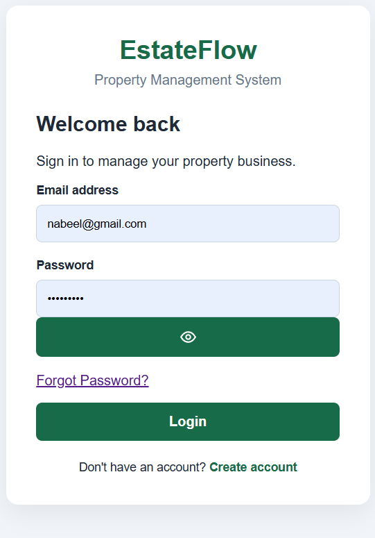
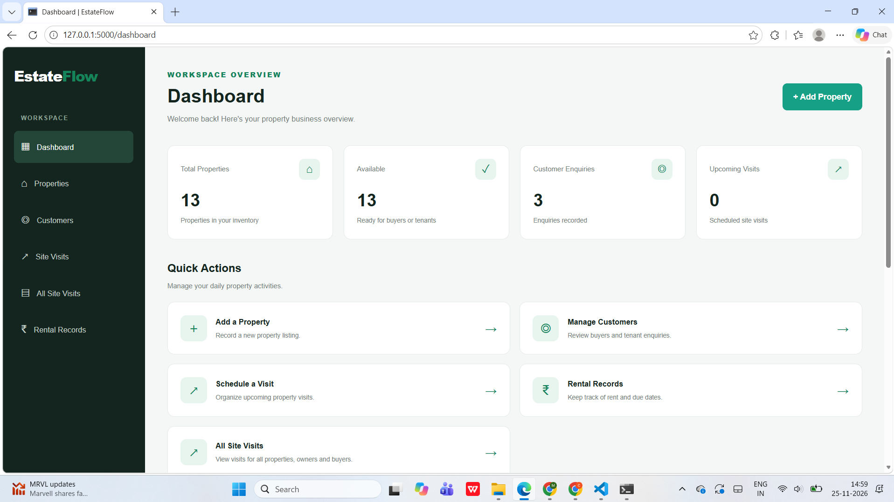
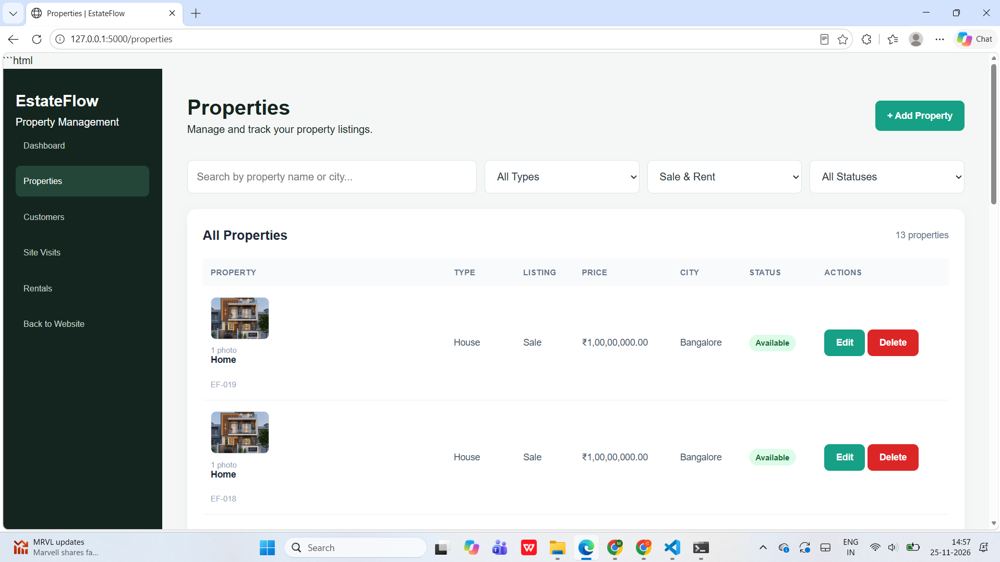
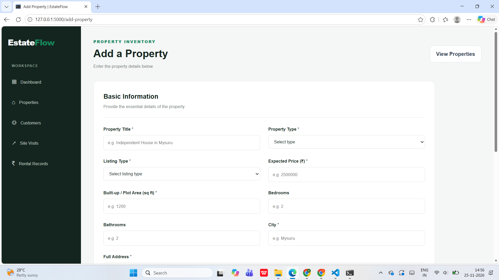
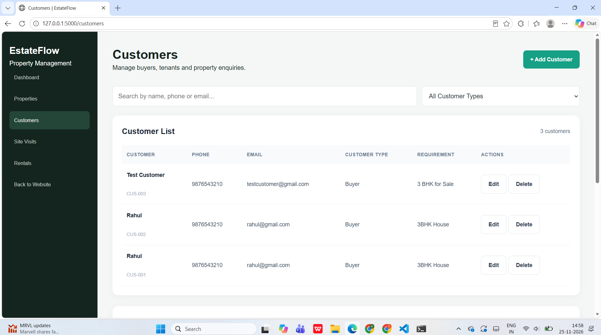

# EstateFlow – Property Management System

A web-based property management application built using Python Flask and MySQL.

## Overview

EstateFlow is designed to simplify property management by providing tools to manage property listings, customers, enquiries, site visits and rental information through a centralized platform.

## Features

- User registration and login
- Property listing and management
- Add, edit and delete properties
- Multiple property photo uploads
- Customer management
- Property enquiries
- Site visit scheduling and tracking
- Rental management
- Owner and user dashboards
- Notifications
- REST API endpoints

## 📸 Application Screenshots

### Login Page


### Dashboard


### Properties


### Add Property


### Customers

## Tech Stack

- **Backend:** Python, Flask
- **Database:** MySQL
- **Frontend:** HTML, CSS, JavaScript
- **API:** REST API, JSON
- **Tools:** VS Code, MySQL Workbench, Postman
- **Security:** Werkzeug password hashing, environment variables

## Project Structure

```text
EstateFlow/
│
├── app.py
├── requirements.txt
├── .env.example
├── .gitignore
│
├── Static/
│   ├── Style.css
│   ├── Script.js
│   └── uploads/
│
└── templates/
```

## Installation and Setup

1. Clone the repository:

```bash
git clone https://github.com/mohmmednabeel/estateflow-property-management.git
```

2. Navigate into the project:

```bash
cd estateflow-property-management
```

3. Install dependencies:

```bash
py -m pip install -r requirements.txt
```

4. Create a MySQL database named `estateflow_db` and prepare the required tables.

5. Create a `.env` file using `.env.example` and configure your local database credentials and Flask secret key.

6. Run the application:

```bash
py app.py
```

7. Open your browser:

```text
http://127.0.0.1:5000
```

## Developer

**Mohammed Nabeel**

Python Full Stack Developer | BCA Graduate

GitHub: https://github.com/mohmmednabeel

---

*This project is developed as a practical application of Python Full Stack development skills.*